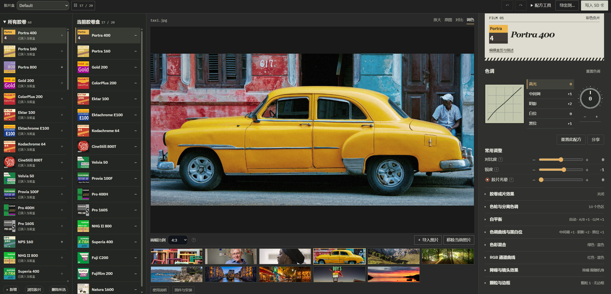

# Nostalgia-OM

**Nostalgia-OM** 是 **OM SYSTEM OM-3** 的一个补丁项目，基于原厂1.1固件 和 Caduceus for OM-3 项目（感谢 androidfanman和 cakelesscoder 的开源和贡献 [OM-3 上游](https://github.com/androidfanman/caduceus-om3) · [PEN E-P7 项目](https://github.com/cakelesscoder/caduceus-ep7)）

提供了定制的胶片选择UI，自定义胶卷色彩编辑和配方导入。并且提供实验性的裂像对焦和赛博透卡功能

[下载 Nostalgia](https://github.com/SengokuCola/Nostalgia-OM/releases) · [使用指南](docs/USING.md) · [报告问题](https://github.com/SengokuCola/Nostalgia-OM/issues)

本仓库的 LookLab 默认打开暗房工作台。可在 Releases 下载 Windows 版，或按[本地运行说明](webapp/README.md)启动。

## 安装

支持 **OM SYSTEM OM-3 原厂固件 1.1**。更新前请给相机电池充满电。

1. 在 Releases 下载 `nostalgia-<版本>.zip` 和 `SHA256SUMS`，核对 ZIP 的 SHA-256 后解压。
2. 运行 `Make SD card files (Windows).bat` 或 `Make SD card files (Mac).command`，需要 Python 3。启动器从 OM 获取原厂固件并在本地打补丁。已有原厂 1.1 文件时也可以运行 `python3 firmware/patch.py --stock 原厂文件路径`。
3. 将生成的 `DCOLYMP` 文件夹复制到 SD 卡根目录。若安装包生成了 `OM3MOD`，请合并其中的文件并保留已有配方。选装的 `LOOKS.BIN`、`CURVES.BIN` 和 `DEBUG.TXT` 位于包内 `releases/<版本>/`。
4. 关闭相机，按住 **OK** 开机。指示灯常亮时正在写入，可能持续约 5 分钟。常亮后转为闪烁再关机。如果开机后立刻闪烁，按下方指南排查文件和 SD 卡。
5. 保存生成的 `restore/E1479999.BIN`。需要恢复原厂 1.1 时，用它替换卡上 `DCOLYMP` 中的同名文件，再按相同方式更新。

[上游安装和故障排查指南](https://androidfanman.github.io/caduceus-om3/pages/install/)

## The 20 film sims

Our own looks, designed from what each film is known for and made only from the camera's own settings. None uses
grain or Glow, so you can add those yourself. The names say what inspired each look; they aren't the film makers'
products or presets. These are LookLab's standard 20 (since 2026-11-13: 18 colour-matched films + CineStill
800T and Kodachrome 64; the v0.28 release's `LOOKS.BIN` still has the earlier 20). In camera order:

| FILM | Name | The look |
|---|---|---|
| 1 | Portra 400 | Warm, soft contrast, natural skin, bright and airy |
| 2 | Portra 160 | The finest Portra: gentle, natural colour and skin, low contrast |
| 3 | Portra 800 | Warmer and richer than Portra 400 |
| 4 | Gold 200 | Warm and golden, rich yellows |
| 5 | ColorPlus 200 | Warm, yellow-golden, softer and more muted than Gold |
| 6 | Ektar 100 | Saturated and punchy, bold reds, clean blues |
| 7 | Ektachrome E100 | Clean, neutral slide colour, crisp, clear blues |
| 8 | Kodachrome 64 | Deep reds, golden yellows, dark rich blues, dense shadows |
| 9 | CineStill 800T | Cool, teal-leaning night look with warm skin and strong reds |
| 10 | Velvia 50 | Very saturated landscape slide, deep blues, lush greens |
| 11 | Provia 100F | Accurate slide colour, clean skies, crisp |
| 12 | Pro 400H | Soft pastels, airy highlights, minty greens, cyan skies |
| 13 | Pro 160S | Natural portrait colour, smooth skin, clean greens |
| 14 | NPS 160 | Soft studio portrait film, gentle skin, cool greens |
| 15 | NHG II 800 | Fast pro film, natural skin, clear greens, deep cool blues |
| 16 | Superia 400 | Green-leaning, cyan skies, snappy |
| 17 | Fuji C200 | Cool greens and blues, clear and airy |
| 18 | Fujifilm 200 | Close to Gold but softer, slightly warm |
| 19 | Fujifilm 400 | Warm and punchy, bright reds, golden yellows |
| 20 | Natura 1600 | Fast, clean and slightly cool, lively reds, soft blacks |

## 授权与署名

Nostalgia 由 SengokuCola 基于 androidfanman 的 Caduceus for OM-3 v0.40.2 开发。Caduceus for OM-3 源自 cakelesscoder 的 Caduceus for PEN E-P7。[OM-3 上游](https://github.com/androidfanman/caduceus-om3) · [PEN E-P7 项目](https://github.com/cakelesscoder/caduceus-ep7)

项目采用 Apache License 2.0。[许可证](LICENSE) · [修改与第三方署名](NOTICE)

## 相较上游的详细改动

- **简体中文界面**覆盖部分机内菜单、胶片控制和 LookLab。
- **手动对焦辅助**在 MF 辅助菜单中提供分像对焦和合焦微调。[对焦实现和诊断记录](research/focus-assist/README.md)
- **Cyber Card（图卡）**为静态 JPEG 添加图卡叠图，支持位置切换和实时取景预览。
- **Film Box** 可以分配到方向键。在实时取景中打开后，转动拨盘浏览胶片，按 **OK** 应用。[Film Box 操作](docs/USING.md#choosing-a-film)
